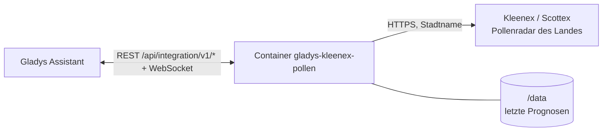
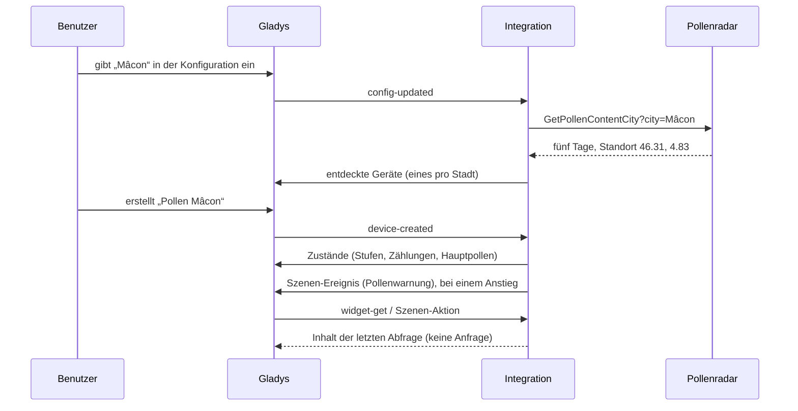
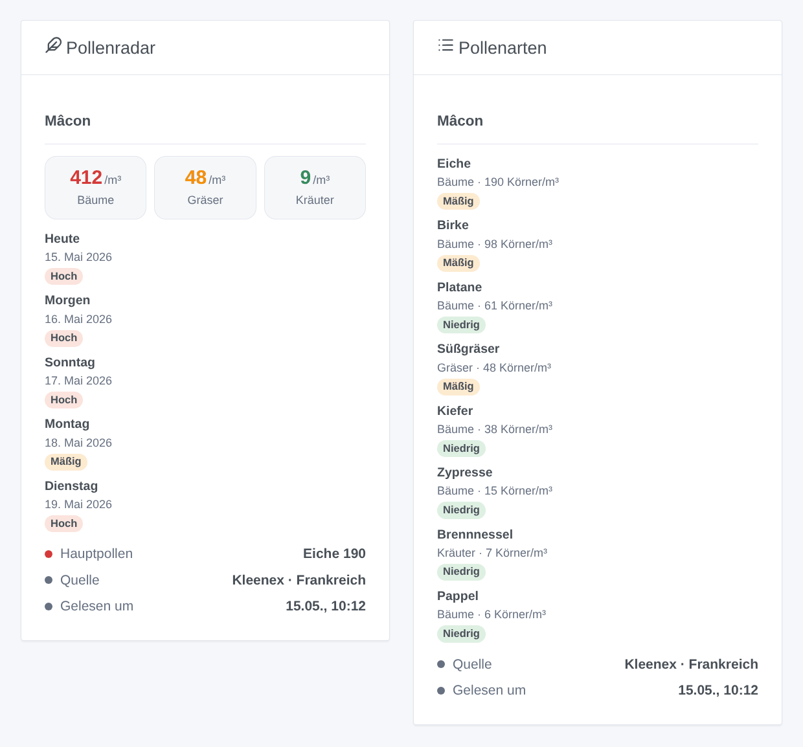

# Gladys Kleenex Pollen Radar

[English](README.md) · [Français](README.fr.md) · **Deutsch** · [Español](README.es.md)

[](LICENSE)
[](https://github.com/William-De71/gladys-kleenex-pollen/releases)
[](https://github.com/William-De71/gladys-kleenex-pollen/actions/workflows/release.yml)
[](https://gladysassistant.com)


Externe Integration für [Gladys Assistant](https://gladysassistant.com) zum **Kleenex-Pollenradar**: die in der Luft Ihrer Stadt gezählten Baum-, Gräser- und Kräuterpollen, ihre Stufe, die Hauptarten und eine Fünf-Tage-Prognose, in Frankreich, im Vereinigten Königreich und Irland, in den Niederlanden, in Italien (Scottex) und in den USA. Ohne Konto, ohne Schlüssel.

Benutzerdokumentation: [English](docs/en.md) · [Français](docs/fr.md) · [Deutsch](docs/de.md) · [Español](docs/es.md).

> Inoffizielle Community-Integration, weder mit Kleenex, Scottex noch Kimberly-Clark verbunden. Das Pollenradar hat keine dokumentierte API: Die Integration liest dieselben Daten wie die Website und braucht womöglich ein Update, wenn sich die Website ändert.

## Funktionen

- **Ein Gerät pro Stadt**, per Name oder Postleitzahl eingegeben, bis zu drei Städte.
- **Pollenstufe** heute und morgen (1 niedrig bis 4 sehr hoch), **Zählung** der Baum-, Gräser- und Kräuterpollen heute (Körner pro m³), **Stufe jeder Gruppe**, **Hauptpollen** als Text.
- **Fünf-Tage-Prognose** und gezählte **Arten** (Birke, Eiche, Ambrosia, Süßgräser…), in vier Sprachen übersetzt.
- **1 Szenen-Auslöser**, **1 Szenen-Aktion** und **2 Dashboard-Widgets** (unten).
- Eine Anfrage pro Stadt alle drei Stunden, im Abstand von zwei Sekunden; die letzte Prognose bleibt über Neustarts erhalten.
- Vier Sprachen überall: Englisch, Französisch, Deutsch, Spanisch.

## Funktionsweise




Für jede Stadt fragt die Integration das Pollenradar des gewählten Landes ab, mit derselben Anfrage wie seine Webseite (`GetPollenContentCity` mit der Stadt, ein Formular-POST in Italien). Die Antwort ist ein HTML-Fragment: fünf Tage, jeder mit Zählung, Stufe und Arten von Bäumen, Gräsern und Kräutern, sowie der Standort der Stadt. Die vom Radar gelieferten Koordinaten, auf zwei Dezimalstellen gerundet, identifizieren das Gerät: Eine andere Schreibweise, die denselben Ort findet, behält es.



### Transport

Nur Cloud (`"transports": ["cloud"]`): Der Katalog zeigt das Cloud-Abzeichen. Die Integration kontaktiert die Kleenex-Website des gewählten Landes (`www.kleenex.fr`, `www.kleenex.co.uk`, `www.kleenex.nl`, `www.kleenex.com`) oder `www.it.scottex.com`; nur die Namen der eingegebenen Städte verlassen Ihr Netzwerk. Es gibt keine lokale Alternative, daher keine Schaltfläche „Lokale Verbindung bevorzugen“.

## Geräte und Funktionen

| Funktion                                 | Kategorie / Typ             | Werte                                    |
| ---------------------------------------- | --------------------------- | ---------------------------------------- |
| Pollenstufe heute, morgen                | `airquality-sensor` / `aqi` | 1 niedrig … 4 sehr hoch (höchste Gruppe) |
| Pollen Bäume, Gräser, Kräuter heute      | `airquality-sensor` / `aqi` | Körner pro m³, 0 … 10 000, ohne Einheit  |
| Pollenstufe Bäume, Gräser, Kräuter heute | `airquality-sensor` / `aqi` | 1 … 4                                    |
| Hauptpollen heute                        | `text` / `text`             | „Ambrosia 13“, „Kräuter 53“, „-“         |

Es wird kein Wert veröffentlicht, wenn das Radar keinen liefert. Gladys hat keine Polleneinheit, und die Einheit `aqi` wäre für eine Zählung oder eine Stufe von 1 bis 4 falsch: Diese Funktionen haben keine Einheit. Gerätenamen und Hauptpollen folgen der eingestellten Sprache.

## Szenen-Auslöser, Aktionen und Widgets



**Szenen-Auslöser** **Kleenex: Pollenwarnung**: Die Baum-, Gräser- oder Kräuterpollen von heute oder morgen erreichen „Mäßig“ oder mehr oder steigen weiter; nie zweimal für denselben Tag, dieselbe Gruppe und Stufe. Filter: Stadt, Pollenart, Tag, Stufen. Variablen: Gruppe, Stufe, Zählung, Arten und eine fertige Zusammenfassung.

**Szenen-Aktion**: **Pollen lesen** für eine Stadt, heute oder morgen: Stufe, Zählungen und Stufe jeder Gruppe, Hauptpollen und eine Zusammenfassung für die folgenden Aktionen.

**Widgets**: **Pollenradar** (die drei Gruppen von heute, eine Karte pro Tag über fünf Tage, Hauptpollen, Quelle und Uhrzeit der Abfrage) und **Pollenarten** (die Arten von heute, die häufigsten zuerst).

Beispiele:

- Wenn **Gräserpollen morgen hoch** sind → abends `{{triggerEvent.data.summary}}` senden und an das Antihistaminikum erinnern.
- Wenn **Baumpollen heute sehr hoch** sind → die Schlafzimmerfenster schließen.
- Jeden Morgen → **Pollen lesen** und mit dem Wecker ansagen.

## Voraussetzungen

- Gladys Assistant **5.1.0** oder neuer (Widgets und Szenen externer Integrationen). Ältere Instanzen können die Integration nicht installieren.
- Eine Stadt, die das Pollenradar eines der fünf Länder kennt.

## Installation

- **Aus dem Store** von Gladys (Integrationen → Externe Integrationen), mit einem Klick, sobald indexiert.
- **Über die Repository-URL**: `https://github.com/William-De71/gladys-kleenex-pollen`.
- **Entwicklermodus**: das Image lokal bauen (`docker build -t gladys-kleenex-pollen .`) und aus Gladys installieren.

## Konfiguration

| Feld              | Beschreibung                                                                     |
| ----------------- | -------------------------------------------------------------------------------- |
| Land              | Frankreich, Vereinigtes Königreich und Irland, Niederlande, Italien, USA.        |
| Stadt (1 bis 3)   | „Mâcon“, „71000“, „Leeds“, „Dublin, Ireland“, „Roma“, „Chicago“…                 |
| Sprache der Texte | Gerätenamen, Hauptpollen, Szenen-Zusammenfassungen (automatisch: Ihr Dashboard). |

Schaltflächen: **Jetzt lesen** (höchstens alle 10 Minuten) und **Diagnose** (schreibt den Zustand der Integration in den Tab Protokolle).

## Verwendung

1. Land wählen und eine Stadt eingeben, dann speichern.
2. Im Tab **Entdecken** das Gerät „Pollen …“ jeder Stadt erstellen.
3. Die Widgets **Pollenradar** und **Pollenarten** zu einem Dashboard hinzufügen und Szenen mit dem Auslöser oben erstellen.

## Entwicklung

```bash
npm install
npm test                       # node --test, nie im Netzwerk
npm run lint && npm run format:check
npx github:GladysAssistant/integration-store . --skip-image-check
scripts/build-cover.sh         # cover.jpg aus docs/assets/cover.svg
docs/illustrations/render.sh   # docs/assets/widgets.<lang>.png
node .github/scripts/release.mjs next
```

Lokal liest das SDK `GLADYS_HOST_API_URL`, `GLADYS_INTEGRATION_TOKEN` und `GLADYS_INTEGRATION_SELECTOR`; `DEBUG=gladys-integration-sdk` zeigt die SDK-Logs und prüft jeden Widget-Inhalt. Die Tests lesen echte Antworten der fünf Radare aus `test/fixtures/`. Die Regeln des Projekts stehen in [CLAUDE.md](CLAUDE.md).

## Veröffentlichungsprozess


Jeder Merge auf `main` startet die CI und berechnet dann die Version aus den [Conventional Commits](https://www.conventionalcommits.org/de/) seit dem letzten Tag: `feat` → Minor, `fix` / `perf` → Patch, `!` oder `BREAKING CHANGE` → Major (unter 1.0.0 ein Minor); `docs`, `chore`, `ci`, `test`, `style`, `refactor`, `build` allein veröffentlichen nichts. Der Changelog-Abschnitt wird erzeugt, der Tag gepusht, das Multi-Architektur-Image gebaut, dann erhält `main` den Release-Commit, das GitHub-Release wird erstellt und ein letzter Job prüft das öffentliche Image, den Store-Validator und das Topic.

- Der Titel des Pull Requests wird zum Squash-Commit und dann zur Changelog-Zeile: auf Englisch, für den Benutzer schreiben (`pr-title.yml` prüft ihn). `CHANGELOG.md` nie von Hand bearbeiten.
- 1.0.0 ist eine Entscheidung: Actions → Release → Run workflow mit `release-as: 1.0.0`. `dry-run` zeigt Version und Notizen, ohne zu veröffentlichen.
- **Geschützter Branch**: Das Release pusht seinen Commit mit `GITHUB_TOKEN` auf `main`. Mit einem Ruleset auf `main` GitHub Actions zur Bypass-Liste hinzufügen (oder über eine GitHub App pushen), sonst schlägt der Veröffentlichungsjob mit Anweisungen fehl.
- Nach dem ersten Release das Paket auf `ghcr.io` öffentlich machen (Package settings → Change visibility), sonst kann Gladys es nicht laden.

## Fehlerbehebung

Siehe [docs/de.md](docs/de.md#fehlerbehebung). Probleme mit den Versionen von Gladys und der Integration, dem Land, der Stadt und den Zeilen der Schaltfläche **Diagnose** melden.

## Mitwirken

Issues und Pull Requests sind willkommen. Vor einem Pull Request `npm run format:check && npm run lint && npm test` ausführen und keine externe ID und keinen gespeicherten Schlüssel ändern (siehe [CLAUDE.md](CLAUDE.md)). Ändert sich die Website, zuerst eine neue Antwort in `test/fixtures/` aufnehmen, dann das Lesen korrigieren.

## Sicherheit

Siehe [SECURITY.md](SECURITY.md): Schwachstellen vertraulich melden. Die Integration hat kein Geheimnis zu schützen: Sie sendet nur die eingegebenen Städtenamen, mit einem User-Agent, der das Projekt nennt.

## Kommende Screenshots

Die Bilder oben sind Illustrationen, keine Screenshots. Echte Screenshots kommen nach `docs/assets/screenshots/` (PNG, 1280 × 800): `configuration.png`, `discovery.png`, `device.png`, `scene.png`.

## Lizenz

[Apache License 2.0](LICENSE) — siehe auch [NOTICE](NOTICE). Die Pollendaten gehören Kleenex / Kimberly-Clark und ihren Anbietern; die Widgets zeigen ihre Quelle. Danke an die Dokumentation und das SDK von Gladys sowie an die Kleenex-Pollenradar-Integration von Home Assistant (MarcoGos/kleenex_pollenradar), die die Adressen dokumentiert hat.
