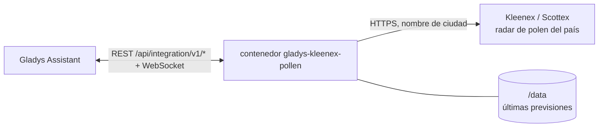
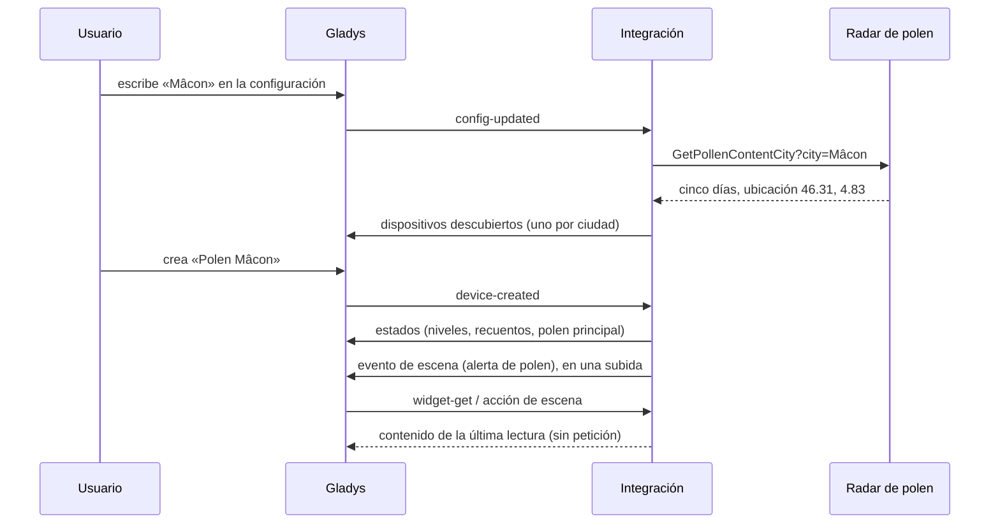
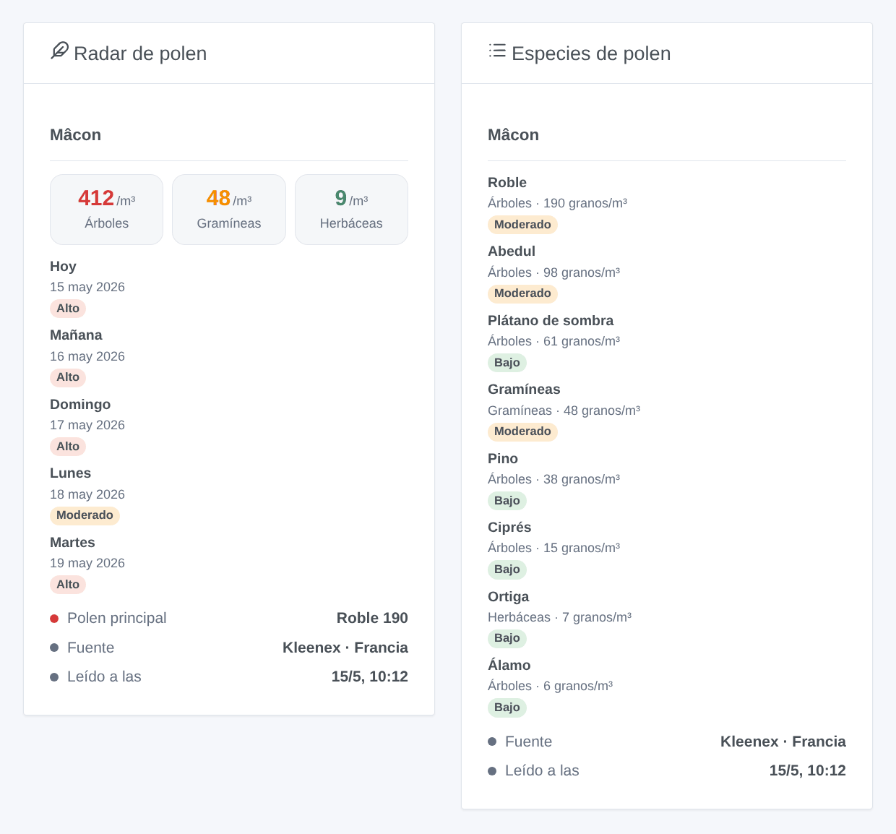

# Gladys Kleenex Pollen Radar

[English](README.md) · [Français](README.fr.md) · [Deutsch](README.de.md) · **Español**

[](LICENSE)
[](https://github.com/William-De71/gladys-kleenex-pollen/releases)
[](https://github.com/William-De71/gladys-kleenex-pollen/actions/workflows/release.yml)
[](https://gladysassistant.com)


Integración externa de [Gladys Assistant](https://gladysassistant.com) para el **radar de polen de Kleenex**: el polen contado en el aire de su ciudad de árboles, gramíneas y herbáceas, su nivel, las especies principales y una previsión de cinco días, en Francia, Reino Unido e Irlanda, Países Bajos, Italia (Scottex) y Estados Unidos. Sin cuenta ni clave.

Documentación de usuario: [English](docs/en.md) · [Français](docs/fr.md) · [Deutsch](docs/de.md) · [Español](docs/es.md).

> Integración comunitaria no oficial, sin afiliación con Kleenex, Scottex ni Kimberly-Clark. El radar de polen no tiene API documentada: la integración lee los mismos datos que el sitio y puede necesitar una actualización cuando el sitio cambie.

## Funcionalidades

- **Un dispositivo por ciudad**, escrita por nombre o código postal, hasta tres ciudades.
- **Nivel de polen** hoy y mañana (1 bajo a 4 muy alto), **recuento** del polen de árboles, gramíneas y herbáceas hoy (granos por m³), **nivel de cada tipo**, **polen principal** como texto.
- **Previsión de cinco días** y **especies** contadas (abedul, roble, ambrosía, gramíneas…), traducidas a cuatro idiomas.
- **1 disparador de escena**, **1 acción de escena** y **2 widgets** de panel (abajo).
- Una petición por ciudad cada tres horas, con dos segundos de separación; la última previsión se conserva entre reinicios.
- Cuatro idiomas en todas partes: inglés, francés, alemán, español.

## Funcionamiento




Para cada ciudad, la integración consulta el radar de polen del país elegido, con la misma petición que su página web (`GetPollenContentCity` con la ciudad, un formulario POST en Italia). La respuesta es un fragmento HTML: cinco días, cada uno con el recuento, el nivel y las especies de árboles, gramíneas y herbáceas, y la ubicación de la ciudad. Las coordenadas que devuelve el radar, redondeadas a dos decimales, identifican el dispositivo: otra grafía que encuentre el mismo lugar lo conserva.



### Transporte

Solo nube (`"transports": ["cloud"]`): el catálogo muestra la insignia de nube. La integración contacta el sitio de Kleenex del país elegido (`www.kleenex.fr`, `www.kleenex.co.uk`, `www.kleenex.nl`, `www.kleenex.com`) o `www.it.scottex.com`; solo los nombres de las ciudades escritas salen de su red. No hay alternativa local, así que no hay botón «Preferir la conexión local».

## Dispositivos y funcionalidades

| Funcionalidad                              | Categoría / tipo            | Valores                               |
| ------------------------------------------ | --------------------------- | ------------------------------------- |
| Nivel de polen hoy, mañana                 | `airquality-sensor` / `aqi` | 1 bajo … 4 muy alto (tipo más alto)   |
| Polen de árboles, gramíneas, herbáceas hoy | `airquality-sensor` / `aqi` | granos por m³, 0 … 10 000, sin unidad |
| Nivel árboles, gramíneas, herbáceas hoy    | `airquality-sensor` / `aqi` | 1 … 4                                 |
| Polen principal hoy                        | `text` / `text`             | «Ambrosía 13», «Herbáceas 53», «-»    |

No se publica ningún valor cuando el radar no lo da. Gladys no tiene unidad para el polen, y la unidad `aqi` sería falsa para un recuento o un nivel de 1 a 4: estas funcionalidades no tienen unidad. Los nombres de los dispositivos y el polen principal siguen el idioma configurado.

## Disparadores, acciones de escena y widgets



**Disparador de escena** **Kleenex: alerta de polen**: el polen de árboles, gramíneas o herbáceas de hoy o de mañana llega a «Moderado» o más, o vuelve a subir; nunca dos veces para el mismo día, tipo y nivel. Filtros: ciudad, tipo de polen, día, niveles. Variables: tipo, nivel, recuento, especies y un resumen listo.

**Acción de escena**: **leer el polen** de una ciudad, hoy o mañana: nivel, recuentos y nivel de cada tipo, polen principal y un resumen para las acciones siguientes.

**Widgets**: **Radar de polen** (los tres tipos de hoy, una tarjeta por día durante cinco días, polen principal, fuente y hora de lectura) y **Especies de polen** (las especies de hoy, las más presentes primero).

Ejemplos:

- Cuando **las gramíneas estén altas mañana** → enviar `{{triggerEvent.data.summary}}` por la tarde y recordar el antihistamínico.
- Cuando **los árboles estén muy altos hoy** → cerrar las ventanas del dormitorio.
- Cada mañana → **leer el polen** y anunciarlo con el despertador.

## Requisitos

- Gladys Assistant **5.3.0** o posterior (palabras clave y países del catálogo de Gladys 5.3, widgets y escenas de las integraciones externas). Las instancias más antiguas no pueden instalar la integración.
- Una ciudad conocida por el radar de polen de uno de los cinco países.

## Instalación

- **Desde la tienda** de Gladys (Integraciones → Integraciones externas), en un clic, una vez indexada.
- **Desde la URL del repositorio**: `https://github.com/William-De71/gladys-kleenex-pollen`.
- **Modo desarrollador**: construya la imagen en local (`docker build -t gladys-kleenex-pollen .`) e instálela desde Gladys.

## Configuración

| Campo                | Descripción                                                                            |
| -------------------- | -------------------------------------------------------------------------------------- |
| País                 | Francia, Reino Unido e Irlanda, Países Bajos, Italia, Estados Unidos.                  |
| Ciudad (1 a 3)       | «Mâcon», «71000», «Leeds», «Dublin, Ireland», «Roma», «Chicago»…                       |
| Idioma de los textos | Nombres de dispositivos, polen principal, resúmenes de escenas (automático: su panel). |

Botones: **Leer ahora** (como mucho cada 10 minutos) y **Diagnóstico** (escribe el estado de la integración en la pestaña Registros).

## Uso

1. Elija el país y escriba una ciudad, luego guarde.
2. En la pestaña **Descubrir**, cree el dispositivo «Polen …» de cada ciudad.
3. Añada los widgets **Radar de polen** y **Especies de polen** a un panel, y cree escenas con el disparador de arriba.

## Desarrollo

```bash
npm install
npm test                       # node --test, nunca toca la red
npm run lint && npm run format:check
npx github:GladysAssistant/integration-store . --skip-image-check
scripts/build-cover.sh         # cover.jpg desde docs/assets/cover.svg
docs/illustrations/render.sh   # docs/assets/widgets.<lang>.png
node .github/scripts/release.mjs next
```

En local, el SDK lee `GLADYS_HOST_API_URL`, `GLADYS_INTEGRATION_TOKEN` y `GLADYS_INTEGRATION_SELECTOR`; `DEBUG=gladys-integration-sdk` muestra los registros del SDK y comprueba cada contenido de widget. Las pruebas leen respuestas reales de los cinco radares guardadas en `test/fixtures/`. Las reglas del proyecto están en [CLAUDE.md](CLAUDE.md).

## Proceso de publicación


Cada fusión en `main` lanza la CI y luego calcula la versión a partir de los [Conventional Commits](https://www.conventionalcommits.org/es/) desde la última etiqueta: `feat` → menor, `fix` / `perf` → parche, `!` o `BREAKING CHANGE` → mayor (una menor por debajo de 1.0.0); `docs`, `chore`, `ci`, `test`, `style`, `refactor`, `build` solos no publican nada. Se genera la sección del changelog, se sube la etiqueta, se construye la imagen multiarquitectura, luego `main` recibe el commit de versión, se crea la GitHub Release y un último job comprueba la imagen pública, el validador de la tienda y el topic.

- El título de la pull request se convierte en el commit squash y luego en la línea del changelog: escríbalo en inglés, para el usuario (`pr-title.yml` lo comprueba). Nunca edite `CHANGELOG.md` a mano.
- La 1.0.0 es una decisión: Actions → Release → Run workflow con `release-as: 1.0.0`. `dry-run` muestra la versión y las notas sin publicar.
- **Rama protegida**: la release sube su commit a `main` con `GITHUB_TOKEN`. Con un ruleset en `main`, añada GitHub Actions a su lista de omisión (o suba mediante una GitHub App); si no, el job de publicación falla con instrucciones.
- Tras la primera release, haga público el paquete `ghcr.io` (Package settings → Change visibility); si no, Gladys no puede descargarlo.

## Solución de problemas

Vea [docs/es.md](docs/es.md#solución-de-problemas). Informe de los problemas con las versiones de Gladys y de la integración, el país, la ciudad y las líneas del botón **Diagnóstico**.

## Contribuir

Las issues y pull requests son bienvenidas. Ejecute `npm run format:check && npm run lint && npm test` antes de abrir una pull request, y no cambie ningún identificador externo ni clave guardada (vea [CLAUDE.md](CLAUDE.md)). Cuando el sitio cambie, guarde una respuesta nueva en `test/fixtures/` antes de corregir la lectura.

## Seguridad

Vea [SECURITY.md](SECURITY.md): informe de las vulnerabilidades en privado. La integración no tiene ningún secreto que guardar: solo envía los nombres de las ciudades escritas, con un user agent que nombra el proyecto.

## Capturas por venir

Las imágenes de arriba son ilustraciones, no capturas de pantalla. Las capturas reales irán en `docs/assets/screenshots/` (PNG, 1280 × 800): `configuration.png`, `discovery.png`, `device.png`, `scene.png`.

## Licencia

[Licencia Apache 2.0](LICENSE) — vea también [NOTICE](NOTICE). Los datos de polen pertenecen a Kleenex / Kimberly-Clark y a sus proveedores; los widgets muestran su fuente. Gracias a la documentación y al SDK de Gladys, y a la integración Kleenex pollen radar de Home Assistant (MarcoGos/kleenex_pollenradar), que documentó las direcciones.
