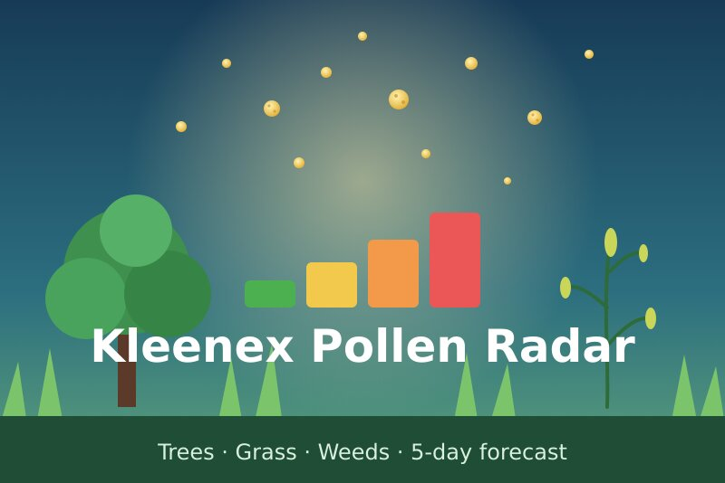
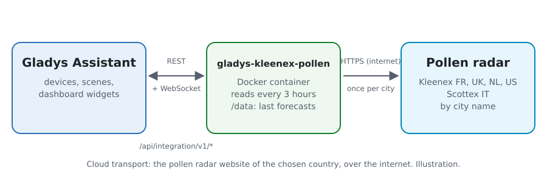
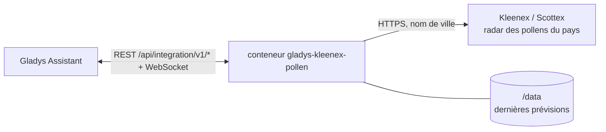
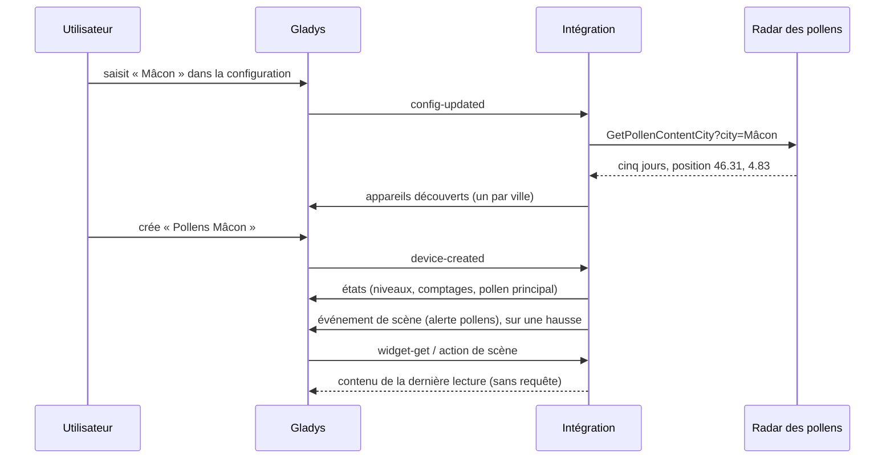
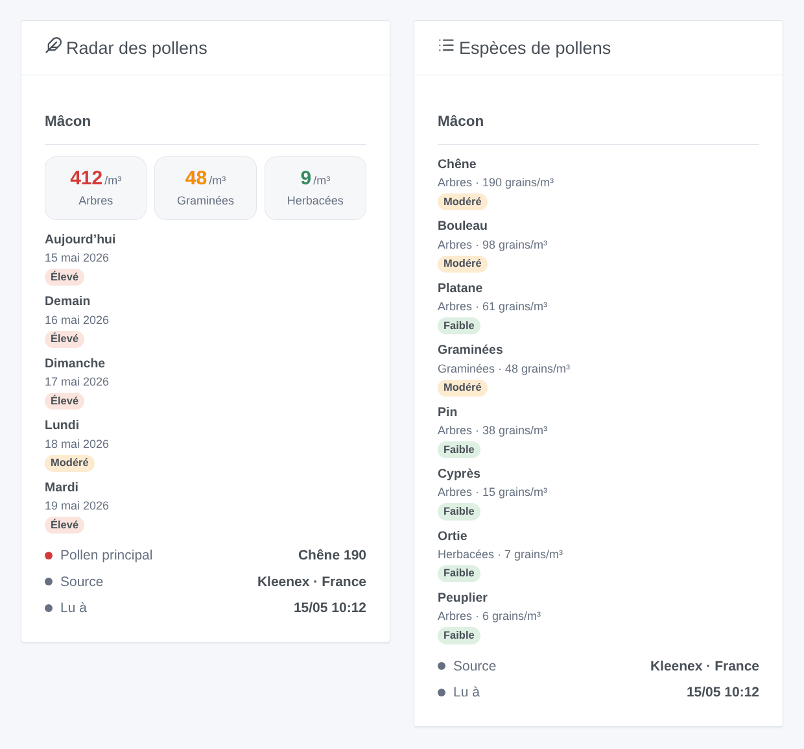

# Gladys Kleenex Pollen Radar

[English](README.md) · **Français** · [Deutsch](README.de.md) · [Español](README.es.md)

[](LICENSE)
[](https://github.com/William-De71/gladys-kleenex-pollen/releases)
[](https://github.com/William-De71/gladys-kleenex-pollen/actions/workflows/release.yml)
[](https://gladysassistant.com)



Intégration externe [Gladys Assistant](https://gladysassistant.com) pour le **radar des pollens Kleenex** : les pollens comptés dans l’air de votre ville pour les arbres, les graminées et les herbacées, leur niveau, les principales espèces et une prévision sur cinq jours, en France, au Royaume-Uni et en Irlande, aux Pays-Bas, en Italie (Scottex) et aux États-Unis. Sans compte ni clé.

Documentation utilisateur : [English](docs/en.md) · [Français](docs/fr.md) · [Deutsch](docs/de.md) · [Español](docs/es.md).

> Intégration communautaire non officielle, affiliée ni à Kleenex, ni à Scottex, ni à Kimberly-Clark. Le radar des pollens n’a pas d’API documentée : l’intégration lit les mêmes données que le site et pourra demander une mise à jour quand le site change.

## Fonctionnalités

- **Un appareil par ville**, saisie par nom ou code postal, jusqu’à trois villes.
- **Niveau de pollens** aujourd’hui et demain (1 faible à 4 très élevé), **comptage** des pollens d’arbres, de graminées et d’herbacées aujourd’hui (grains par m³), **niveau de chaque type**, **pollen principal** en texte.
- **Prévision sur cinq jours** et **espèces** comptées (bouleau, chêne, ambroisie, graminées…), traduites en quatre langues.
- **1 déclencheur de scène**, **1 action de scène** et **2 widgets** de tableau de bord (ci-dessous).
- Une requête par ville toutes les trois heures, à deux secondes d’intervalle ; la dernière prévision est gardée entre deux redémarrages.
- Quatre langues partout : anglais, français, allemand, espagnol.

## Fonctionnement





Pour chaque ville, l’intégration interroge le radar des pollens du pays choisi, avec la même requête que sa page web (`GetPollenContentCity` avec la ville, un formulaire POST en Italie). La réponse est un fragment HTML : cinq jours, chacun avec le comptage, le niveau et les espèces des arbres, graminées et herbacées, et la position de la ville. Les coordonnées renvoyées par le radar, arrondies à deux décimales, identifient l’appareil : une autre orthographe qui trouve le même endroit le garde.



### Transport

Cloud uniquement (`"transports": ["cloud"]`) : le catalogue affiche le badge cloud. L’intégration contacte le site Kleenex du pays choisi (`www.kleenex.fr`, `www.kleenex.co.uk`, `www.kleenex.nl`, `www.kleenex.com`) ou `www.it.scottex.com` ; seuls les noms des villes saisies sortent de votre réseau. Il n’existe pas d’alternative locale, donc pas de bouton « Préférer la connexion locale ».

## Appareils et fonctionnalités

| Fonctionnalité                        | Catégorie / type            | Valeurs                                     |
| ------------------------------------- | --------------------------- | ------------------------------------------- |
| Niveau de pollens aujourd’hui, demain | `airquality-sensor` / `aqi` | 1 faible … 4 très élevé (type le plus haut) |
| Pollens arbres, graminées, herbacées  | `airquality-sensor` / `aqi` | grains par m³, 0 … 10 000, sans unité       |
| Niveau arbres, graminées, herbacées   | `airquality-sensor` / `aqi` | 1 … 4                                       |
| Pollen principal aujourd’hui          | `text` / `text`             | « Ambroisie 13 », « Herbacées 53 », « - »   |

Aucune valeur n’est publiée quand le radar n’en donne pas. Gladys n’a pas d’unité pour les pollens, et l’unité `aqi` serait fausse pour un comptage ou un niveau de 1 à 4 : ces fonctionnalités n’ont pas d’unité. Les noms des appareils et le pollen principal suivent la langue configurée.

## Déclencheurs, actions de scène et widgets



**Déclencheur de scène** **Kleenex : alerte pollens** : les pollens d’arbres, de graminées ou d’herbacées d’aujourd’hui ou de demain atteignent « Modéré » ou plus, ou augmentent encore ; jamais deux fois pour le même jour, type et niveau. Filtres : ville, type de pollen, jour, niveaux. Variables : type, niveau, comptage, espèces et un résumé tout prêt.

**Action de scène** : **lire les pollens** d’une ville, aujourd’hui ou demain : niveau, comptages et niveau de chaque type, pollen principal et un résumé pour les actions suivantes.

**Widgets** : **Radar des pollens** (les trois types du jour, une carte par jour sur cinq jours, pollen principal, source et heure de lecture) et **Espèces de pollens** (les espèces du jour, les plus présentes d’abord).

Exemples :

- Quand **les graminées sont élevées demain** → envoyer `{{triggerEvent.data.summary}}` le soir et rappeler de prendre l’antihistaminique.
- Quand **les arbres sont très élevés aujourd’hui** → fermer les fenêtres de la chambre.
- Chaque matin → **lire les pollens** et les annoncer avec le réveil.

## Prérequis

- Gladys Assistant **5.3.0** ou plus récent (mots-clés et pays du catalogue de Gladys 5.3, widgets et scènes des intégrations externes). Les instances plus anciennes ne peuvent pas installer l’intégration.
- Une ville connue du radar des pollens de l’un des cinq pays.

## Installation

- **Depuis le store** de Gladys (Intégrations → Intégrations externes), en un clic, une fois indexée.
- **Depuis l’URL du dépôt** : `https://github.com/William-De71/gladys-kleenex-pollen`.
- **Mode développeur** : construisez l’image en local (`docker build -t gladys-kleenex-pollen .`) et installez-la depuis Gladys.

## Configuration

| Champ             | Description                                                                               |
| ----------------- | ----------------------------------------------------------------------------------------- |
| Pays              | France, Royaume-Uni et Irlande, Pays-Bas, Italie, États-Unis.                             |
| Ville (1 à 3)     | « Mâcon », « 71000 », « Leeds », « Dublin, Ireland », « Roma », « Chicago »…              |
| Langue des textes | Noms des appareils, pollen principal, résumés des scènes (automatique : tableau de bord). |

Boutons : **Lire maintenant** (au plus toutes les 10 minutes) et **Diagnostic** (écrit l’état de l’intégration dans l’onglet Journaux).

## Utilisation

1. Choisissez le pays et saisissez une ville, puis enregistrez.
2. Dans l’onglet **Découverte**, créez l’appareil « Pollens … » de chaque ville.
3. Ajoutez les widgets **Radar des pollens** et **Espèces de pollens** à un tableau de bord, et créez des scènes avec le déclencheur ci-dessus.

## Développement

```bash
npm install
npm test                       # node --test, ne touche jamais le réseau
npm run lint && npm run format:check
npx github:GladysAssistant/integration-store . --skip-image-check
scripts/build-cover.sh         # cover.jpg depuis docs/assets/cover.svg
docs/illustrations/render.sh   # docs/assets/widgets.<lang>.png
node .github/scripts/release.mjs next
```

En local, le SDK lit `GLADYS_HOST_API_URL`, `GLADYS_INTEGRATION_TOKEN` et `GLADYS_INTEGRATION_SELECTOR` ; `DEBUG=gladys-integration-sdk` affiche les journaux du SDK et vérifie chaque contenu de widget. Les tests lisent des réponses réelles des cinq radars enregistrées dans `test/fixtures/`. Les règles du projet sont dans [CLAUDE.md](CLAUDE.md).

## Publication des versions


Chaque fusion sur `main` lance la CI, puis calcule la version à partir des [Conventional Commits](https://www.conventionalcommits.org/fr/) depuis le dernier tag : `feat` → mineure, `fix` / `perf` → correctif, `!` ou `BREAKING CHANGE` → majeure (une mineure tant qu’on est sous 1.0.0) ; `docs`, `chore`, `ci`, `test`, `style`, `refactor`, `build` seuls ne publient rien. La section du changelog est générée, le tag poussé, l’image multi-architecture construite, puis `main` reçoit le commit de version, la GitHub Release est créée et un dernier job vérifie l’image publique, le validateur du store et le topic.

- Le titre de la pull request devient le commit squashé, puis la ligne du changelog : écrivez-le en anglais, pour l’utilisateur (`pr-title.yml` le vérifie). N’éditez jamais `CHANGELOG.md` à la main.
- La 1.0.0 est une décision : Actions → Release → Run workflow avec `release-as: 1.0.0`. `dry-run` affiche la version et les notes sans rien publier.
- **Branche protégée** : la release pousse son commit sur `main` avec `GITHUB_TOKEN`. Avec un ruleset sur `main`, ajoutez GitHub Actions à sa liste de contournement (ou poussez via une GitHub App), sinon le job de publication échoue avec la marche à suivre.
- Après la première release, rendez public le paquet `ghcr.io` (Package settings → Change visibility), sinon Gladys ne peut pas le télécharger.

## Dépannage

Voir [docs/fr.md](docs/fr.md#dépannage). Signalez un problème avec les versions de Gladys et de l’intégration, le pays, la ville et les lignes du bouton **Diagnostic**.

## Contribuer

Les issues et pull requests sont les bienvenues. Lancez `npm run format:check && npm run lint && npm test` avant d’ouvrir une pull request, et ne changez aucun identifiant externe ni aucune clé stockée (voir [CLAUDE.md](CLAUDE.md)). Quand le site change, enregistrez une nouvelle réponse dans `test/fixtures/` avant de corriger la lecture.

## Sécurité

Voir [SECURITY.md](SECURITY.md) : signalez les vulnérabilités en privé. L’intégration n’a aucun secret à garder : elle n’envoie que les noms des villes saisies, avec un user agent qui nomme le projet.

## Captures à venir

Les images ci-dessus sont des illustrations, pas des captures d’écran. Les vraies captures iront dans `docs/assets/screenshots/` (PNG, 1280 × 800) : `configuration.png`, `discovery.png`, `device.png`, `scene.png`.

## Licence

[Licence Apache 2.0](LICENSE) — voir aussi [NOTICE](NOTICE). Les données de pollens appartiennent à Kleenex / Kimberly-Clark et à leurs fournisseurs ; les widgets affichent leur source. Merci à la documentation et au SDK de Gladys, et à l’intégration Kleenex pollen radar de Home Assistant (MarcoGos/kleenex_pollenradar), qui a documenté les adresses.
