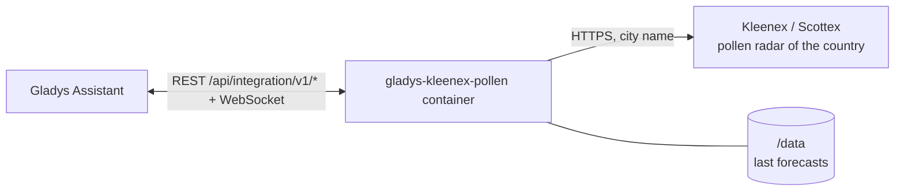
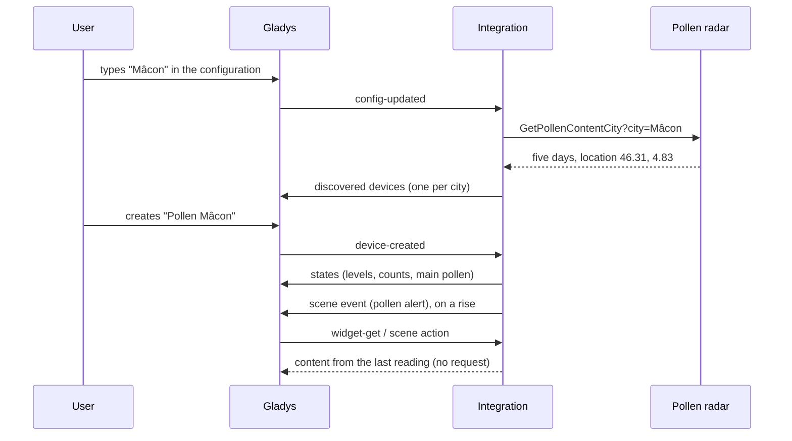
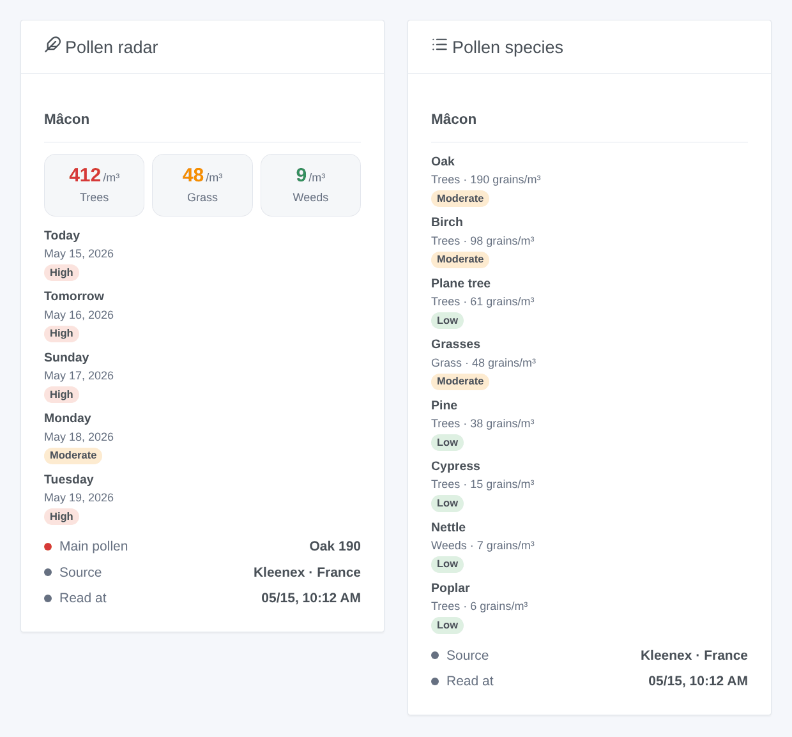

# Gladys Kleenex Pollen Radar

**English** · [Français](README.fr.md) · [Deutsch](README.de.md) · [Español](README.es.md)

[](LICENSE)
[](https://github.com/William-De71/gladys-kleenex-pollen/releases)
[](https://github.com/William-De71/gladys-kleenex-pollen/actions/workflows/release.yml)
[](https://gladysassistant.com)


[Gladys Assistant](https://gladysassistant.com) external integration for the **Kleenex pollen radar**: the pollen counted in the air of your city for trees, grass and weeds, their level, the main species and a five-day forecast, in France, the United Kingdom and Ireland, the Netherlands, Italy (Scottex) and the United States. No account, no key.

User documentation: [English](docs/en.md) · [Français](docs/fr.md) · [Deutsch](docs/de.md) · [Español](docs/es.md).

> Unofficial community integration, affiliated with neither Kleenex, Scottex nor Kimberly-Clark. The pollen radar has no documented API: the integration reads the same data as the website and may need an update when the site changes.

## Features

- **One device per city**, typed by name or postal code, up to three cities.
- **Pollen level** today and tomorrow (1 low to 4 very high), **count** of trees, grass and weeds pollen today (grains per m³), **level of each type**, **main pollen** as text.
- **Five-day forecast** and the **species** counted (birch, oak, ragweed, grasses…), translated into four languages.
- **1 scene trigger**, **1 scene action** and **2 dashboard widgets** (below).
- One request per city every three hours, two seconds apart; the last forecast is kept across restarts.
- Four languages everywhere: English, French, German, Spanish.

## How it works




For each city, the integration asks the pollen radar of the chosen country, the same request as its web page (`GetPollenContentCity` with the city, a form POST in Italy). The answer is an HTML fragment: five days, each with the count, level and species of trees, grass and weeds, and the location of the city. The coordinates the radar answers, rounded to two decimals, identify the device: a new spelling that finds the same place keeps it.



### Transport

Cloud only (`"transports": ["cloud"]`): the catalog shows the cloud badge. The integration contacts the Kleenex website of the chosen country (`www.kleenex.fr`, `www.kleenex.co.uk`, `www.kleenex.nl`, `www.kleenex.com`) or `www.it.scottex.com`; only the names of the typed cities leave your network. There is no local alternative, so there is no "prefer the local connection" button.

## Devices and features

| Feature                                | Category / type             | Values                             |
| -------------------------------------- | --------------------------- | ---------------------------------- |
| Pollen level today, tomorrow           | `airquality-sensor` / `aqi` | 1 low … 4 very high (highest type) |
| Trees, grass, weeds pollen today       | `airquality-sensor` / `aqi` | grains per m³, 0 … 10 000, no unit |
| Trees, grass, weeds pollen level today | `airquality-sensor` / `aqi` | 1 … 4                              |
| Main pollen today                      | `text` / `text`             | "Ragweed 13", "Weeds 53", "-"      |

No value is published when the radar gives none. Gladys has no pollen unit and the `aqi` unit would be wrong for a count or a level from 1 to 4: these features have no unit. The device names and the main pollen follow the configured language.

## Scene triggers, actions and widgets



**Scene trigger** **Kleenex: pollen alert**: the trees, grass or weeds pollen of today or tomorrow reaches "Moderate" or more, or rises again; never twice for the same day, type and level. Filters: city, pollen type, day, levels. Variables: type, level, count, species and a ready-made summary.

**Scene action**: **read the pollen** of a city, today or tomorrow: level, counts and level of each type, main pollen and a summary for the following actions.

**Widgets**: **Pollen radar** (the three types of today, a card per day over five days, main pollen, source and reading time) and **Pollen species** (the species of today, highest first).

Examples:

- When **grass pollen is high tomorrow** → send `{{triggerEvent.data.summary}}` in the evening and remind to take the antihistamine.
- When **trees pollen is very high today** → close the bedroom windows.
- Every morning → **read the pollen** and announce it with the alarm.

## Requirements

- Gladys Assistant **5.1.0** or later (widgets and scenes of external integrations). Older instances cannot install the integration.
- A city known to the pollen radar of one of the five countries.

## Installation

- **From the store** of Gladys (Integrations → External integrations), in one click, once indexed.
- **From the repository URL**: `https://github.com/William-De71/gladys-kleenex-pollen`.
- **Developer mode**: build the image locally (`docker build -t gladys-kleenex-pollen .`) and install it from Gladys.

## Configuration

| Field                 | Description                                                             |
| --------------------- | ----------------------------------------------------------------------- |
| Country               | France, United Kingdom and Ireland, Netherlands, Italy, United States.  |
| City (1 to 3)         | "Mâcon", "71000", "Leeds", "Dublin, Ireland", "Roma", "Chicago"…        |
| Language of the texts | Device names, main pollen, scene summaries (automatic: your dashboard). |

Buttons: **Read now** (at most every 10 minutes) and **Diagnostic** (writes the state of the integration to the Logs tab).

## Usage

1. Choose the country and type a city, then save.
2. In the **Discover** tab, create the "Pollen …" device of each city.
3. Add the **Pollen radar** and **Pollen species** widgets to a dashboard, and build scenes with the trigger above.

## Development

```bash
npm install
npm test                       # node --test, never touches the network
npm run lint && npm run format:check
npx github:GladysAssistant/integration-store . --skip-image-check
scripts/build-cover.sh         # cover.jpg from docs/assets/cover.svg
docs/illustrations/render.sh   # docs/assets/widgets.<lang>.png
node .github/scripts/release.mjs next
```

Locally, the SDK reads `GLADYS_HOST_API_URL`, `GLADYS_INTEGRATION_TOKEN` and `GLADYS_INTEGRATION_SELECTOR`; `DEBUG=gladys-integration-sdk` shows the SDK logs and checks every widget content. The tests read real answers of the five radars recorded in `test/fixtures/`. The rules of the project are in [CLAUDE.md](CLAUDE.md).

## Release process


Every merge on `main` runs the CI, then computes the version from the [Conventional Commits](https://www.conventionalcommits.org/) since the last tag: `feat` → minor, `fix` / `perf` → patch, `!` or `BREAKING CHANGE` → major (a minor below 1.0.0); `docs`, `chore`, `ci`, `test`, `style`, `refactor`, `build` alone publish nothing. The changelog section is generated, the tag pushed, the multi-architecture image built, then `main` receives the release commit, the GitHub Release is created and a last job checks the public image, the store validator and the topic.

- The pull request title becomes the squash commit, then the changelog line: write it in English, for the user (`pr-title.yml` checks it). Never edit `CHANGELOG.md` by hand.
- 1.0.0 is a decision: Actions → Release → Run workflow with `release-as: 1.0.0`. `dry-run` shows the version and the notes without publishing.
- **Protected branch**: the release pushes its commit to `main` with `GITHUB_TOKEN`. With a ruleset on `main`, add GitHub Actions to its bypass list (or push through a GitHub App), otherwise the publish job fails with instructions.
- After the first release, make the `ghcr.io` package public (Package settings → Change visibility), or Gladys cannot pull it.

## Troubleshooting

See [docs/en.md](docs/en.md#troubleshooting). Report issues with the versions of Gladys and of the integration, the country, the city, and the lines of the **Diagnostic** button.

## Contributing

Issues and pull requests are welcome. Run `npm run format:check && npm run lint && npm test` before opening a pull request, and keep every external id and stored key unchanged (see [CLAUDE.md](CLAUDE.md)). When the site changes, record a new answer in `test/fixtures/` before fixing the reader.

## Security

See [SECURITY.md](SECURITY.md): report vulnerabilities privately. The integration has no secret to keep: it sends only the typed city names, with a user agent naming the project.

## Screenshots to come

The images above are illustrations, not screenshots. Real screenshots will go in `docs/assets/screenshots/` (PNG, 1280 × 800): `configuration.png`, `discovery.png`, `device.png`, `scene.png`.

## License

[Apache License 2.0](LICENSE) — see also [NOTICE](NOTICE). The pollen data belong to Kleenex / Kimberly-Clark and their providers; the widgets show their source. Thanks to the Gladys documentation and SDK, and to the Kleenex pollen radar integration of Home Assistant (MarcoGos/kleenex_pollenradar), which documented the endpoints.
